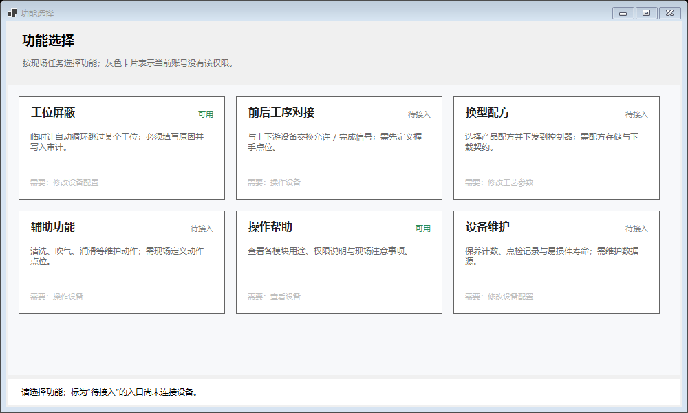
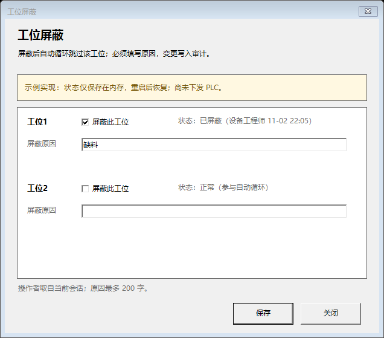

# 16 · 功能选择（Function Selection）

> 状态：**示例已交付**（2026-11-02）。页面 `FunctionSelectionPage`、示例功能 `StationBypassDialog`
> 与帮助 `OperationHelpDialog` 已接入；工位屏蔽为内存实现，其余四个入口标记“待接入”。
> 本文是该功能的规格：页面结构、功能目录、权限/审计边界与新增功能的步骤。

---

## 1. 定位与边界

`功能选择` 是**现场任务的入口集合**，不是独立业务域：每个卡片背后是一个具体功能
（屏蔽工位、换型、维护），由各自的对话框或页面承载。

**它负责**：

- 把“现场要做的六件事”固定成一级导航下的任务清单；
- 按当前账号权限决定卡片可用 / 置灰（只影响外观）；
- 对尚未接入的功能明确显示“待接入”和缺什么契约，而不是打开一个空窗口。

**它不负责**：

- 自动流程编排、节拍、配方下载 —— 这些属于各自的业务服务；
- 安全回路 —— 急停、安全门、机械硬限位由 PLC 与硬接线兜底；
- 权限判定 —— 页面只用 `HasPermission` 提示，真正的拦截在服务入口的 `RequirePermission`。

---

## 2. 页面结构

```
FunctionSelectionPage
├─ 标题 / 副标题（权限提示）
├─ FlowLayoutPanel：六张卡片（运行期按 FunctionCatalog 生成）
│    ┌──────────────┐ ┌──────────────┐ ┌──────────────┐
│    │ 工位屏蔽  可用 │ │ 前后工序 待接入│ │ 换型配方 待接入│
│    │ 说明…          │ │ 说明…          │ │ 说明…          │
│    │ 需要：修改设备配置│ │ 需要：操作设备  │ │ 需要：修改工艺参数│
│    └──────────────┘ └──────────────┘ └──────────────┘
└─ 底部状态栏：点击结果 / 缺少权限 / 待接入说明
```



设计要点：

- **卡片常显、无权限置灰**。导航层按权限隐藏整页；页内不再隐藏卡片，
  因为现场需要区分“没这个功能”和“这个账号没权限”。置灰卡片右上角显示“无权限”，
  底部说明缺哪个权限点。
- **卡片是运行期生成的**（`FunctionSelectionPage.cs`），Designer 只保留表头、网格容器与状态栏；
  坐标只出现在 `.Designer.cs`，卡片是局部变量，不受布局守卫限制。
- **状态栏是唯一反馈**：不弹 MessageBox 打断巡检；打开对话框后把保存结果写回状态栏。

---

## 3. 功能目录

唯一真相：`src/EquipmentMonitor.Desktop/FunctionSelection/FunctionCatalog.cs`。

| Key | 卡片 | 权限 | 状态 | 接入条件 / 说明 |
|---|---|---|---|---|
| `station-bypass` | 工位屏蔽 | `MachineConfig` | **示例已接** | 见 §5；内存实现，接设备时替换服务 |
| `line-handshake` | 前后工序对接 | `MachineOperate` | 待接入 | 需先定义上下游握手点位（允许 / 完成 / 故障） |
| `recipe-change` | 换型配方 | `ProcessConfig` | 待接入 | 需配方存储、版本与下载/回读契约 |
| `auxiliary` | 辅助功能 | `MachineOperate` | 待接入 | 清洗 / 吹气 / 润滑的动作点位待现场定义 |
| `operation-help` | 操作帮助 | `MachineView` | **已接** | 静态说明，无设备依赖 |
| `maintenance` | 设备维护 | `MachineConfig` | 待接入 | 需保养计数、点检记录的数据源 |

约定：

- `Key` 是稳定标识，用于分发处理程序；**改标题不改 Key**。
- 条目的 `Summary` 必须写清“未来接什么 / 缺什么契约”，它同时是待接入提示文案。
- 新增条目只改目录；要真正打开界面，再在页面的分发方法里加一个 `case`。

---

## 4. 权限与审计

| 层 | 做什么 | 不做什么 |
|---|---|---|
| `MainForm` 导航 | `HasPermission(MachineView)` 决定整页是否出现 | 不校验页内操作 |
| `FunctionSelectionPage` | `HasPermission(entry.Required)` 决定卡片置灰 | 不抛异常、不写审计 |
| 功能服务（如 `IStationBypassService`） | `RequirePermission` 失败抛异常 | 不依赖界面状态 |
| 审计 | 有副作用的写操作由服务写 `AuditEventTypes.*` | 打开帮助、浏览列表不写审计 |

工位屏蔽新增审计事件：

```csharp
public const string StationBypassChanged = "STATION_BYPASS_CHANGED";
```

审计内容示例：`工位1 屏蔽，原因：缺料`；操作者由 `LogAuditService` 从会话补齐，
调用点不重复传。审计失败不回滚已生效的状态（与 `IAuditService` 的约定一致），
服务会捕获审计异常并记 Warning，用户仍看到“保存成功”；现场以“状态 + 日志”两条线互相印证。

---

## 5. 代码案例：工位屏蔽

### 5.1 契约（Core）

```csharp
public interface IStationBypassService
{
    IReadOnlyList<StationBypassState> GetStates();

    Task<Result> SetAsync(
        int stationId,
        bool bypassed,
        string reason,
        CancellationToken cancellationToken = default);
}
```

- 读：返回按工位编号排序的不可变快照（UI 可任意线程读）。
- 写：入口 `RequirePermission(MachineConfig)`；未知工位、原因为空、原因超长返回 `Result.Fail`；
  重复设置相同状态是幂等操作，不重复写审计。
- 生效方式由实现决定：接设备的实现必须在返回成功前完成 PLC/配置写入并回读，
  不能“先返回成功、后台再补写”。

### 5.2 示例实现（Infrastructure）

`src/EquipmentMonitor.Infrastructure/StationBypass/StationBypassService.cs`：

- 进程内 `Dictionary<int, StationBypassState>` + 一把锁串行化读写；
- 审计在锁外写，避免日志 IO 拖住状态读取；
- 操作者显示名取自 `ISessionProvider.Current`，未登录记为 `(未登录)`；
- **这是示例**：重启后恢复为“全部正常”，尚未下发 PLC；DI 注册处与弹窗内都有提示。

### 5.3 页面分发（Desktop）

```csharp
switch (entry.Key)
{
    case FunctionCatalog.StationBypassKey:
        OpenStationBypass();          // 打开 StationBypassDialog
        break;

    case FunctionCatalog.HelpKey:
        using (var dialog = new OperationHelpDialog())
        {
            dialog.ShowDialog(this);
        }
        break;

    default:
        SetStatus($"「{entry.Title}」入口已就绪，但处理程序尚未注册。");
        break;
}
```

分发前统一做两件事：`Planned` 直接提示；`!HasPermission` 直接提示。处理程序内部不再重复判权限。

### 5.4 弹窗（Desktop）

`StationBypassDialog`：

- 每个工位一行：状态、屏蔽勾选、原因输入（`MaxLength = 200`）；
- 无 `MachineConfig` 时整窗只读：勾选与输入禁用、保存禁用、横幅改为红字提示；
- 保存前二次确认，列出“屏蔽工位1 / 恢复工位2”的变更清单；
- 逐个调用 `SetAsync`，任何一个失败立即停止并显示失败原因；
- 成功后回读状态（`ReloadStates`），把摘要交给页面状态栏（`SaveSummary`）。



---

## 6. 新增一个功能的步骤

1. **目录**：在 `FunctionCatalog.All` 加一条（Key / 标题 / 说明 / 权限 / `Ready` 或 `Planned`）。
2. **契约**：有设备副作用就放 `Core/Abstractions`，实现放 `Infrastructure`，并在
   `InfrastructureModuleRegister` 注册；只读的纯数据源可以留在 Desktop（参考 `IParameterPageSource`）。
3. **界面**：新建对话框/页面（`X.cs` + `X.Designer.cs`，在 `.csproj` 补 `SubType`/`DependentUpon`），
   在页面的 `switch` 里加分支。
4. **测试**：服务层测权限、校验、审计；页面层测“无权限只提示”“待接入不打开”。
5. **文档**：更新 §3 的状态表与 [10-desktop.md](10-desktop.md) 的模块表。

---

## 7. 测试

| 测试 | 覆盖 |
|---|---|
| `StationBypassServiceTests`（7 条） | 越权抛异常且不写审计；原因必填；状态 + 操作者 + 审计；恢复；幂等；未知工位；审计失败不影响结果 |
| `FunctionSelectionPageTests`（5 条） | 容器能解析页面；六个入口、Key 唯一；卡片数量；无权限只提示；待接入说明 |
| `DesignerConventionTests` / `LayoutConventionTests` | 新窗体分部类与布局单源 |

---

## 8. 待决问题

1. **工位屏蔽写哪里**：自动循环由 PLC 控制，上位机是写“屏蔽位”寄存器还是只改本地配置？
   若是寄存器，需要地址、回读与掉电保持策略；在此之前本服务保持内存实现。
2. **最后一个工位能否屏蔽**：是否需要禁止“全部工位都被屏蔽”，避免自动循环空转？
3. **恢复是否需要原因**：当前恢复允许空原因；现场若要求“谁恢复、为什么恢复”留痕，再收紧为必填。
4. **换型配方契约**：配方存储、版本、下载/回读、失败回滚都未定义，需单独设计文档。
5. **审计落库**：当前审计只写结构化日志；工位屏蔽属于配置类变更，落库后需支持按工位/操作者查询。
